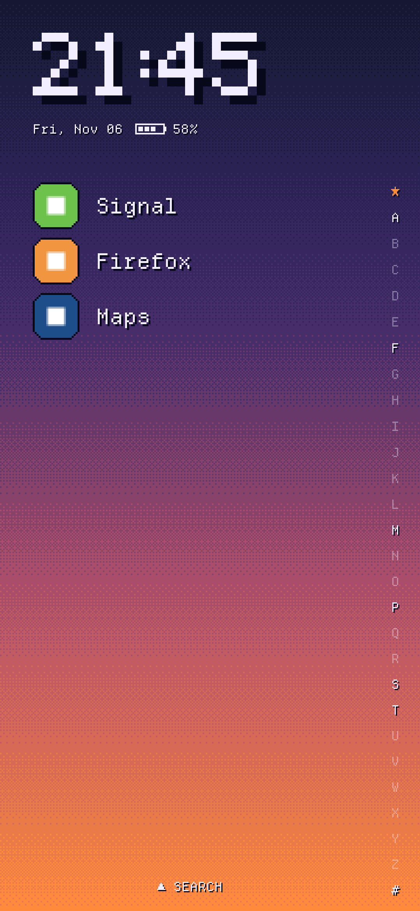
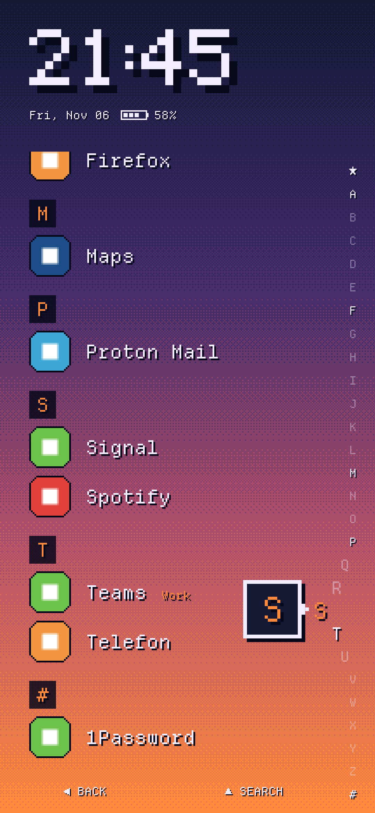
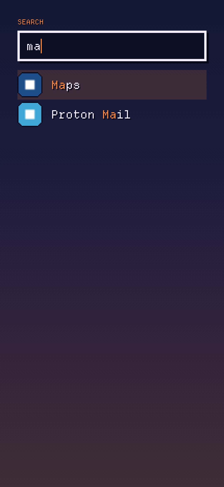
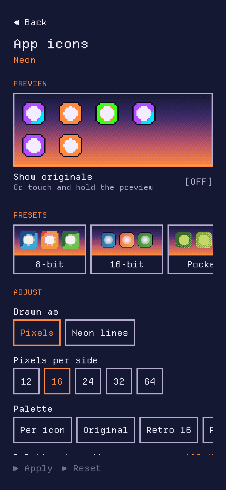

# PixelBuddy

[](https://github.com/nobuddyorg/PixelBuddy/actions/workflows/ci.yml)
[](https://github.com/nobuddyorg/PixelBuddy/actions/workflows/codeql.yml)
[](LICENSE)

A minimalist Android launcher with a retro-game / pixel-art look: Niagara's calm layout, a pixel clock, a battery
HP bar, a dithered navy→purple→orange sky and pixelized app icons.

<p>
  
  
  
  
</p>

- **Home:** big pixel clock, date, battery as an HP bar and optional weather; your favorites; an alphabet rail with
  haptic ticks; swipe up to search (accents, word starts and initials match).
- **Pixel icons:** every app icon pixelated in one of five presets or drawn as glowing neon lines, or your own style
  made in the live editor; single apps can get their own style, layer or picture.
- **Your look:** accent colours, six sky gradients or a sky that follows the sun (night, dawn, day, dusk), dithering,
  CRT scanlines, clock, text and icon sizes, and the sky as your wallpaper (home and lock screen), optionally kept in sync.
- **Private by design:** no tracking, no ads, no accounts. The only network access is optional weather.
- **Fast and small:** no background work, no services, under 3.5 MB.
- **Accessible:** TalkBack labels, 48 dp touch targets, large fonts and display sizes are tested.
- **English and German.**

> **Status:** the [MVP](https://github.com/nobuddyorg/PixelBuddy/issues/1) is being finished, see the
> [plan](docs/PLAN.md).

## Install

PixelBuddy is distributed as a signed APK on [GitHub Releases](https://github.com/nobuddyorg/PixelBuddy/releases).
It needs Android 10 (API 29) or newer; the primary test device is a Galaxy S24 with One UI 9.

### With Obtainium (recommended, gets updates)

1. Install [Obtainium](https://github.com/ImranR98/Obtainium).
2. Add app → source URL `https://github.com/nobuddyorg/PixelBuddy`.
3. Install. Obtainium checks GitHub Releases for new versions (`PixelBuddy-vX.Y.Z.apk`).

### Manually

1. Download `PixelBuddy-vX.Y.Z.apk` and `SHA256SUMS` from the latest release.
2. Optional, check the download:
   - `sha256sum --check SHA256SUMS` (macOS: `shasum -a 256 -c SHA256SUMS`)
   - provenance: `gh attestation verify PixelBuddy-vX.Y.Z.apk --repo nobuddyorg/PixelBuddy`
3. Open the APK on the phone and allow your browser or file manager to install unknown apps when asked.

**Samsung:** *Auto Blocker* (Settings → Security and privacy → Auto Blocker) blocks apps from outside the Galaxy
Store. Turn it off for the install, or install over USB with `adb install PixelBuddy-vX.Y.Z.apk` (works with Auto
Blocker on).

Updates must come from the same signing key, so always install over the previous release.

### Google developer verification

Google is rolling out [developer verification](https://developer.android.com/developer-verification) for apps on
certified Android devices. Since 30 September 2026 it applies to apps from participating stores (Google Play, Galaxy
Store and other device makers' stores) in Brazil, Indonesia, Singapore and Thailand. Direct downloads like PixelBuddy's
are not covered yet; global rollout is planned for 2027. PixelBuddy will be registered before then
([#18](https://github.com/nobuddyorg/PixelBuddy/issues/18)), so installs and updates keep working as above.

If your device ever refuses the APK as coming from an unverified developer:

- **ADB** stays exempt: `adb install -r PixelBuddy-vX.Y.Z.apk` (`-r` keeps your settings when updating).
- Or use Android's one-time *advanced flow*: enable developer options, restart, wait the one-day protection period,
  then allow apps from unverified developers. Keep it enabled, otherwise updates to unregistered apps fail.

## Using it

The first start walks you through three steps you can skip: make PixelBuddy the home app, pick favorites, and
choose the weather (or none). You can run it again from the settings. To set the home app yourself: Settings →
Apps → Choose default apps → Home app.

| On home | Does |
|---|---|
| Tap an app | Opens it, growing out of its icon |
| Long-press an app | The app's shortcuts (e.g. "New message"), favorite, move, edit icon, hide, app info, uninstall |
| Tap or drag the alphabet rail | All apps, at that letter (◄ Back returns) |
| Swipe up / ▲ Search | Search (opens when you let go); Enter opens the top match |
| Swipe down | Notifications |
| Long-press empty space | Settings |
| Double-tap empty space | Nothing, or e.g. lock the screen (opt-in) |
| Tap an app's notification dot | Shows its newest notification to open or dismiss (opt-in) |
| Play/pause, skip below the date | Controls the playing music or podcast (opt-in) |
| Tap the next event below the date | Opens it in the calendar (opt-in) |
| A widget with the favorites | Any app's widget, above or below them (Settings → Widget) |
| Tap the clock / the date / the weather | Alarms / calendar / refresh (or an app you choose) |

The swipes, the double tap and the long press can be changed in Settings → Gestures. Locking the screen needs
PixelBuddy's lock service, an accessibility service that does nothing else (see [PRIVACY.md](PRIVACY.md)). Settings → Back up & move exports everything
to one file for a new phone.

Maintainers: see [docs/RELEASING.md](docs/RELEASING.md).

## Build

Requirements: JDK 17 or newer and the Android SDK with platform `android-37.2`.

```sh
./gradlew :app:assembleDebug                     # debug APK (installs next to a release as …pixelbuddy.debug)
./gradlew spotlessCheck build :koverVerifyUnit   # everything CI checks
```

More commands, code style and how to update dependencies: [CONTRIBUTING.md](CONTRIBUTING.md).

## Contributing

PixelBuddy is a personal hobby project and doesn't accept outside pull requests, issues or feature requests; they
are closed without review. Security problems are the exception: report them privately as described in
[SECURITY.md](SECURITY.md). Want to change something? Fork it: [CONTRIBUTING.md](CONTRIBUTING.md) has why, local
setup, and the checks CI runs.

## Project documents

| Document | Contents |
|---|---|
| [docs/PLAN.md](docs/PLAN.md) | Decisions, architecture, order of work |
| [CONTRIBUTING.md](CONTRIBUTING.md) | No outside contributions, forking, setup, commands, code style |
| [PRIVACY.md](PRIVACY.md) | What data PixelBuddy uses and sends (almost nothing) |
| [SECURITY.md](SECURITY.md) | Supported versions and how to report a vulnerability privately |
| [docs/RELEASING.md](docs/RELEASING.md) | Release workflow, signing key, APK size budget |
| [LICENSE](LICENSE) | MIT |
